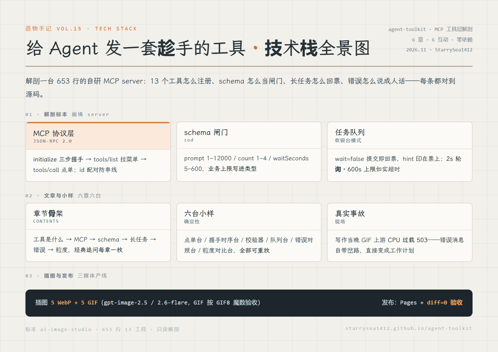

# 造物手记 VOL.15 · 给 Agent 发一套趁手的工具

MCP 工具层解剖：模型点单、运行时端菜、工具台供货。解剖一台 653 行的自研 MCP server——13 个工具、zod 菜单闸门、收银台队列、三层错误账本。

- 在线阅读：<https://starrysea1412.github.io/agent-toolkit/>
- 标本：ai-image-studio 画境 server（653 行 · 13 工具 · 只读解剖）
- 6 章 + 6 段确定性互动；零依赖单页
- 系列后一册：VOL.16《给 Agent 装一块驾驶舱》（agent-cockpit）
